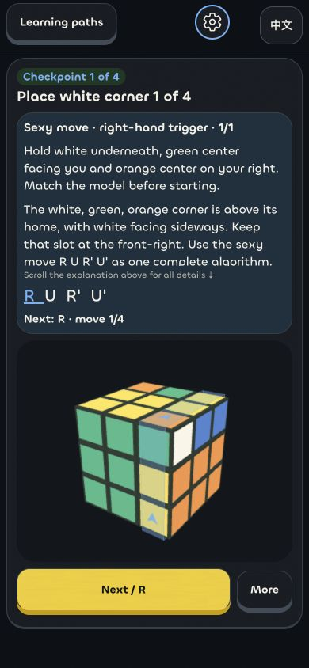
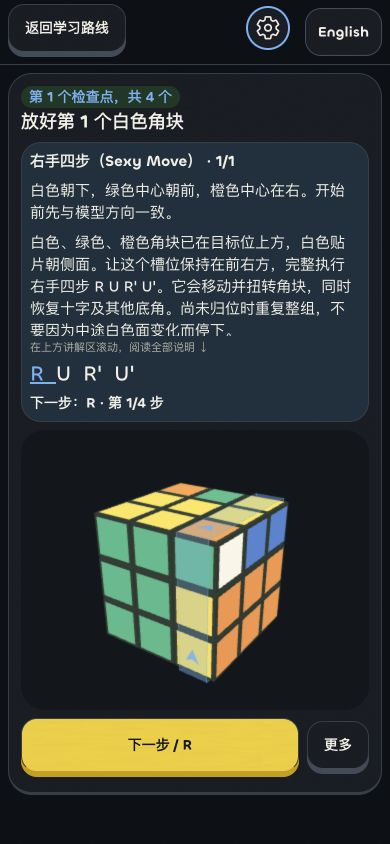

# Learning algorithms in Cubers

Updated 2026-10-30.

Beginners learn a reusable algorithm, its setup and its purpose. The tutorial still uses the learner’s validated cube colors and stops at the selected lesson target.

## A corner lesson

1. Identify the corner using all three colors and locate its matching bottom slot.
2. Match the model’s holding direction so the working slot is at the front-right. A regrip turns the entire cube in the hands; it does not twist a layer or alter the saved state.
3. If the corner is trapped below, use the right-hand trigger once to lift it. Otherwise observe whether white faces upward or sideways.
4. Turn the top layer to align the corner directly above its own slot, when alignment is needed.
5. Learn and perform **R U R' U'**, commonly called the sexy move. Repeat the complete four-move trigger as needed. The cross and other bottom corners return after each complete group.
6. Check the corner’s three colors after the group, rather than judging a temporary position halfway through it.

The explanation comes from the cube at the beginning of each group. It stays visible as the learner turns; only the next move, highlighted notation and directional cue change. A different move suppresses the suggested cursor until undo, restart or a new scan restores a matching state.

Other guided stages explain their complete insertion, orientation, exchange or setup–exchange–restore groups. Fixed authored drills retain their published bilingual explanation throughout their complete sequence. Saved older plans remain usable; an older three-turn insertion is not relabeled as a four-turn sexy move.

## The ribbon and phone layout

For cubes, a translucent ribbon wraps around the **side stickers of the selected layer**. It is perpendicular to the turning face and follows that layer’s perimeter. Traveling arrows show its rotation direction; primes reverse the travel and half-turn notation remains explicit. Wide turns use a wider ribbon. The ribbon follows the same holding frame as the notation and model. Pyraminx uses separate vertex/tip cues.

Reduced motion keeps the directional arrows static. Text notation remains available. The 3D canvas updates its drawing size and camera projection when its surface changes size.

On phones, the explanation scrolls inside a bounded reader and the algorithm stays on one horizontally scrollable strip. The cube and primary action have reserved space. **More** reveals manual turns, undo, reset, demonstrations, downloads and saved-practice controls. The developer gear sits in the header on phone tutorial routes. Large accessibility text and unusually short screens retain scrolling rather than clipping content.

  
  

## Continue now, check at the end of the unit

After completing an intermediate part’s full algorithm, **Continue** advances the tutorial without an intermediate check. **More → Check this part now** retains the immediate-check option. Smart-cube and downloaded guidance also provide **Continue without checking**.

- An unchecked continuation saves only the model’s guide position and an explicitly unverified event. It does not award course completion or a review, and it does not claim a physical scan or independent hardware check occurred.
- The option is limited to parts of the same unit. Scoped lessons such as first-layer corners form one unit. A complete first-solve journey uses its distinct solving stages as unit boundaries.
- A unit’s last check cannot be skipped. Virtual practice uses server-validated turns; scanned practice still needs a fresh final scan; smart practice retains its independent hardware-state/counter verification.
- Downloaded practice stays local and grants no online credit. Physical downloaded practice still requires a fresh scan at unit ends and after an interruption.
- Users can rescan or update guidance when a physical cube differs from the predicted model. The camera does not continuously observe hidden turns.

## Verification and limits

The final source suite passes **485 tests**. Coverage includes 250 random legal cube states through complete corner triggers, prior cross/corner preservation, geometry-equivalent regrips and wide-turn notation, explanation stability in both languages, all six face directions, reduced-motion cues, side-sticker ribbon placement on 2×2/3×3/4×4, canvas resizing, offline continuation and unit boundaries. Workspace type checks and the project build pass.

Three reserved-database acceptance tests exercise virtual/scanned continuation and synthetic smart-cube guidance. They reject incomplete algorithms, stale versions, foreign ownership and final-check bypasses, and verify that Progress remains empty until the final check succeeds. Actual Bluetooth hardware is not represented by these synthetic tests.

Browser checks verify English and Chinese dark-mode phone layouts, including 320×568 and 390×844. A measured 320×568 move update keeps the cube at `(21, 317, 278, 153)` and the next button at `(21, 478, 208, 54)`, with identical explanation text and no outer page overflow. Full algorithm completion, continuation, final verification and recovery from a temporary connection timeout were exercised using a synthetic account. The final algorithm run emits no new browser warning/error. Light-mode physical-device acceptance is not claimed by these captures.

Fresh [development APK and unsigned IPA packages](DEVELOPMENT-BUILDS.md#current-artifacts) contain matching current sources and both bundled fonts. Their identities remain separate from production. Production native source files were restored unchanged after compilation. iPhone installation still needs Apple signing/provisioning; real-phone camera/cube, Bluetooth and iPhone runtime acceptance remain separate. No real AI provider, public deployment, production activation or fresh public npm audit was used.
